# Hi, I’m Fabiano Rong

I’m a full-stack developer based in Florianópolis, Brazil. I build web apps that help people work with data, from healthcare scheduling to League of Legends analysis.

<picture>
  <source media="(prefers-color-scheme: dark)" srcset="assets/duel-dark.svg">
  
</picture>

## Selected projects

- **[WebLol](https://github.com/bsanoli/WebLol)** · I contribute to a League of Legends workspace with match statistics, draft planning, and a tactical map.
- **[Panda Healthcare](https://github.com/fabianorong/panda-healthcare)** · A patient portal for booking and managing appointments.
- **[Treine](https://github.com/fabianorong/treine)** · A responsive landing page for a fitness SaaS.

## Tools I use

TypeScript · JavaScript · React · Node.js · Tailwind CSS · PostgreSQL · MySQL · Python · Figma · GitHub

## Education

Food Engineering at UFSC and postgraduate studies in Software Engineering at PUC Minas.

[Portfolio](https://fabianorong.vercel.app/) · [LinkedIn](https://www.linkedin.com/in/fabianorong/)
