<picture>
  <source media="(prefers-color-scheme: dark)" srcset="assets/duel-motion-dark.svg">
  
</picture>

## Selected projects

- **[CFLOL](https://cflol.com.br/)** · Tournament site for Foz’s League of Legends championship, with schedules, results, and player stats.
- **[WebLol](https://github.com/bsanoli/WebLol)** · I contribute to a League of Legends workspace with match statistics, draft planning, and a tactical map.

## Tools I use

TypeScript · JavaScript · React · Node.js · Tailwind CSS · PostgreSQL · MySQL · Python · Figma · GitHub

## Education

Food Engineering at UFSC and postgraduate studies in Software Engineering at PUC Minas.

[Portfolio](https://fabianorong.vercel.app/) · [LinkedIn](https://www.linkedin.com/in/fabianorong/)
